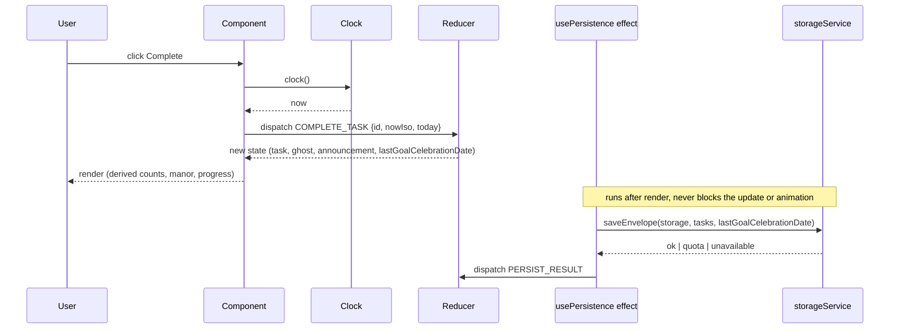
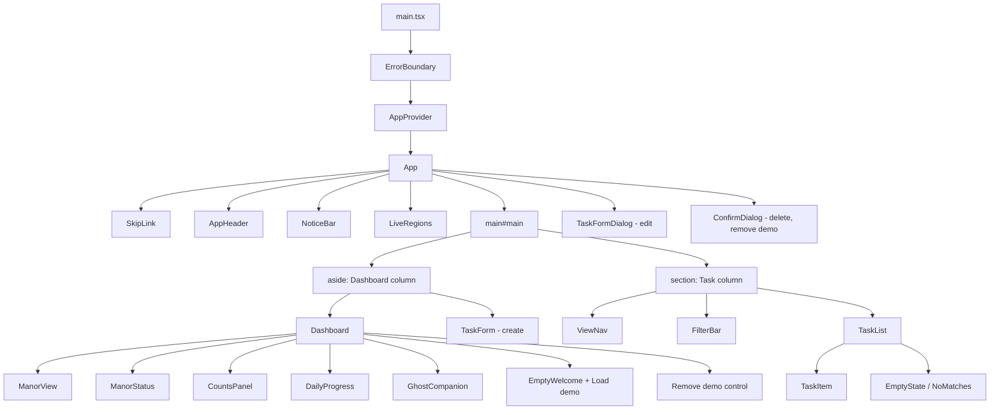
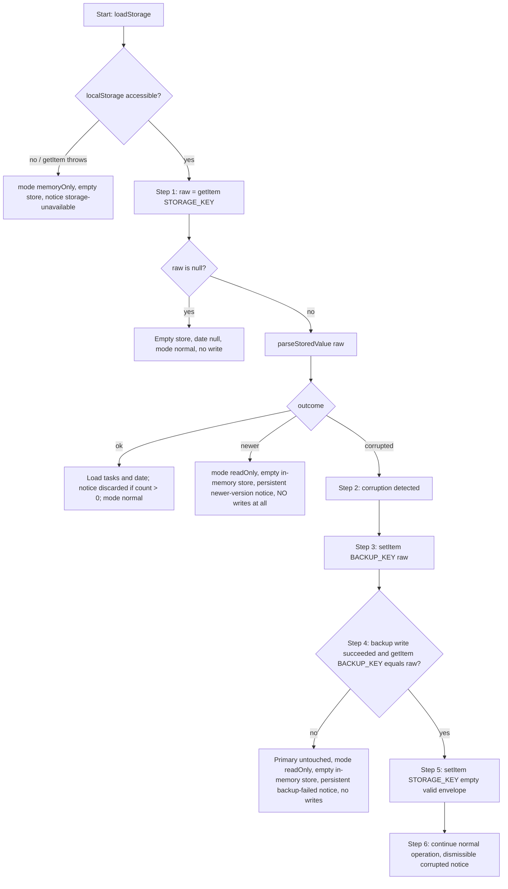
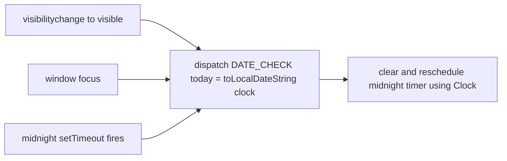
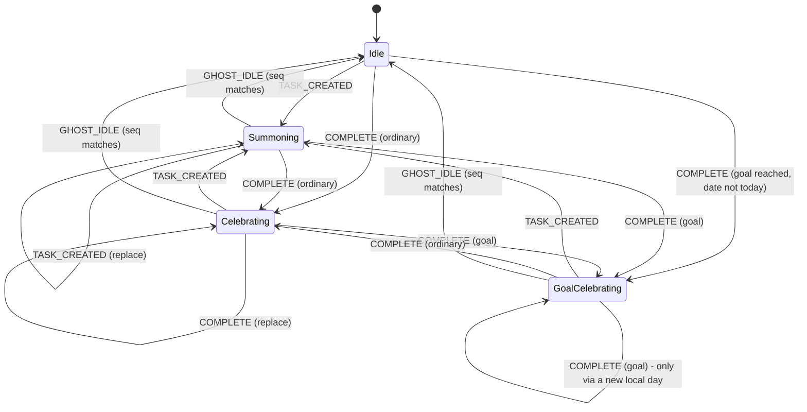

# Design Document

## Overview

Spectral Tasks is a client-side React + TypeScript + Vite single-page app. Users "summon" tasks as spirits, "release" them by completing them, and watch a haunted manor restore as completed tasks accumulate. Everything runs in the browser and persists to LocalStorage. There is no backend, authentication, cloud database or paid API.

The design follows three rules that keep it realistic for a solo student developer:

1. **Pure logic first.** Dates, validation, task operations, views, filters, sorting, manor stage, ghost decisions, demo data and storage parsing are plain TypeScript functions with no React and no browser globals. They are the bulk of the tests (AC-NFR-01.2, AC-NFR-01.3).
2. **One thin impure edge for storage.** A small `storageService` is the only module that touches `localStorage`. It receives a storage object as a parameter, so tests pass a mock.
3. **One state container.** A single `useReducer` plus React context holds all state. Everything else (counts, progress, manor stage, views) is derived at render time and never stored (AC-PERS-01.7).

### Technology and Dependencies

| Kind | Packages | Notes |
|------|----------|-------|
| Runtime (only these three, AC-NFR-01.5) | `react`, `react-dom`, `lucide-react` | IDs, dates, validation and the modal/focus trap are hand-written. |
| Dev (required by the stated stack) | `vite`, `@vitejs/plugin-react`, `typescript`, `vitest`, `jsdom`, `@testing-library/react` | Build and test tooling only. |
| Dev (additions, flagged) | `@testing-library/user-event`, `@testing-library/jest-dom` | Realistic keyboard/focus tests and readable assertions. Dev-only. |
| Dev (addition, flagged) | `fast-check` | Property-based testing. Justified because the app has many pure functions with universal properties (round-trip, monotonicity, partition, once-per-day) and the requirements name these properties explicitly (AC-PERS-01.5, AC-MANOR-01.9). Dev-only; not shipped. |

TypeScript runs with `"strict": true`, and `any` is banned in application code through the `@typescript-eslint/no-explicit-any` rule or code review (AC-NFR-01.1). If ESLint is not added, `tsc --noEmit` plus a grep check in the test script covers this, so no extra tooling is mandated.

### Key Design Decisions

| # | Decision | Rationale |
|---|----------|-----------|
| D1 | `useReducer` + context, one reducer file | Beginner-friendly, no library, all transitions testable as a pure function `(state, action) => state`. Redux or Zustand would add a dependency without benefit at this size. |
| D2 | Reducer is pure: time and ids arrive in the action payload | Tests use plain values; no fake clock needed to test the reducer. The Clock lives only in event handlers and hooks. |
| D3 | Derived state computed with selectors, memoized with `useMemo` | Satisfies AC-PERS-01.7. No stale counts. |
| D4 | Initial load runs once in `main.tsx` before rendering | React StrictMode double-invokes initializers; recovery has write side effects (backup, replace) and must run exactly once. |
| D5 | Manor is an inline SVG with CSS stage classes | Resolves OQ-6. See "Manor Rendering Decision". |
| D6 | Custom `Modal` component with focus trap | `<dialog>.showModal()` is not fully supported by jsdom, which would make focus tests unreliable. A 60-line component is enough. |
| D7 | Ghost animation is CSS only; reducer never waits on it | AC-GHOST-01.18, AC-A11Y-02.6. |
| D8 | Date changes detected by `visibilitychange`, `focus` and one midnight `setTimeout`, never by polling | AC-DATE-01.13. |
| D9 | `fast-check` as dev dependency | See table above. |
| D10 | Stored Task field rules follow Requirement 13 types exactly; form limits (100/1000 chars, 1 to 1440 minutes) are not applied when reading | Tolerant reading avoids discarding data for rules the spec only places on the form (AC-PERS-02.14 refers to Requirement 13). |

## Architecture

### Layers and Service Boundaries

```mermaid
flowchart TB
  subgraph React["React layer (components, hooks)"]
    C[Components]
    H[useDateChangeCheck / useAppState]
  end
  subgraph State["State layer"]
    R[reducer.ts - pure]
    CTX[AppContext - useReducer]
  end
  subgraph Domain["Pure domain layer - no React, no browser globals"]
    D1[dates.ts]
    D2[validation.ts]
    D3[tasks.ts]
    D4[selectors.ts]
    D5[manor.ts]
    D6[ghost.ts]
    D7[demo.ts]
    D8[envelope.ts]
  end
  subgraph Edge["Impure edge"]
    S[storageService.ts - takes a StorageLike]
    LS[(localStorage)]
    CK[Clock = () => Date]
  end
  C --> CTX
  H --> CTX
  CTX --> R
  R --> D1
  R --> D3
  R --> D5
  R --> D6
  C --> D4
  C --> D2
  CTX --> S
  S --> D8
  S --> LS
  H --> CK
```

| Boundary | Allowed to use | Not allowed to use |
|----------|----------------|--------------------|
| `domain/*` | other `domain/*` modules, TypeScript types | React, `window`, `document`, `localStorage`, `Date.now()`, `Math.random()` (time and ids are parameters) |
| `storage/envelope.ts` | `domain/*` | any browser global |
| `storage/storageService.ts` | `envelope.ts`, a `StorageLike` parameter | React |
| `state/reducer.ts` | `domain/*` | the Clock, storage, timers |
| components and hooks | everything above, the Clock, DOM events | direct `localStorage` access |

### Folder Structure

```
spectral-tasks/
  index.html
  package.json, tsconfig.json, vite.config.ts   (vitest config lives in vite.config.ts)
  scripts/perf/generate-dataset.ts              (seeded data set, AC-PERF-01.4)
  docs/performance.md                           (measurement procedure and recorded results)
  src/
    main.tsx                 load storage once, create initial state, render
    App.tsx                  providers, layout, error boundary
    domain/
      types.ts               Task, enums, Filters, ViewId, Notice, etc.
      constants.ts           DAILY_GOAL, MANOR_STAGES, limits, storage keys
      dates.ts               Clock type, local date helpers, next-midnight
      validation.ts          validateTaskInput (form), isRealCalendarDate
      tasks.ts               createTask, updateTask, completeTask, reopenTask
      selectors.ts           views, filters, sorting, counts, progress, overdue
      manor.ts               getManorStage, getNextStageInfo
      ghost.ts               decideCompletionReaction, ghost messages
      demo.ts                createDemoTasks, removeDemoTasks
      ids.ts                 createId (crypto.randomUUID with fallback)
    storage/
      envelope.ts            serializeEnvelope, parseStoredValue, migrations registry
      storageService.ts      loadStorage, saveEnvelope
    state/
      reducer.ts, actions.ts, initialState.ts
      AppContext.tsx         provider, useAppState, useAppDispatch
      useDateChangeCheck.ts  visibility, focus, midnight timer
      usePersistence.ts      write effect
    components/
      layout/   AppHeader, SkipLink, ErrorBoundary, NoticeBar, LiveRegions
      dashboard/ Dashboard, ManorView, ManorStatus, CountsPanel, DailyProgress, GhostCompanion, EmptyWelcome
      tasks/    TaskForm, TaskFormDialog, ViewNav, FilterBar, TaskList, TaskItem, EmptyState
      common/   Modal, ConfirmDialog, VisuallyHidden
    styles/
      tokens.css, base.css, layout.css, components.css, manor.css, motion.css
    test/
      setup.ts, factories.ts, fakeStorage.ts
```

Test files sit next to the module they test (`dates.test.ts`, `reducer.test.ts`, `TaskForm.test.tsx`).

### Data Flow



The state change is applied and rendered before persistence runs, and animations are CSS only, so no animation can delay or block a task operation (AC-GHOST-01.18, AC-A11Y-02.6).

## Components and Interfaces

### Component Tree



### Component Responsibilities

| Component | Responsibility | Requirements |
|-----------|----------------|--------------|
| `ErrorBoundary` | Catches render errors, shows a themed fallback message instead of a blank screen. | AC-NFR-01.9 |
| `SkipLink` | First focusable element, jumps to `#main`. | AC-A11Y-01.10 |
| `AppHeader` | `<header>` with app name (h1). | AC-A11Y-01.7 |
| `NoticeBar` | Renders `state.notices` (corruption, discarded count, read-only, unavailable, quota). Dismissible ones have a close button; persistent ones do not. | AC-PERS-02.3, .5, .6, .8, .9, .15 |
| `LiveRegions` | Two visually hidden `aria-live="polite"` regions: one for action announcements, one for the ghost message (the ghost message is also visible text). | AC-A11Y-01.8, AC-GHOST-01.9, AC-GHOST-01.17 |
| `Dashboard` | Composes manor, status, counts, progress, ghost, welcome state and demo controls. | AC-DASH-01.1 to .6, .9 |
| `ManorView` | Inline SVG for the current stage with a text alternative. | AC-MANOR-01.3, .4, .10 |
| `ManorStatus` | Stage name, remaining count to next stage, or the fully restored message, plus the stage-increase announcement. | AC-MANOR-01.6 to .8 |
| `DailyProgress` | Text "N of 3" and a `<progress>` element. | AC-DASH-01.3 |
| `GhostCompanion` | Renders idle or reaction pose from `state.ghost`, shows the message, schedules the return to idle. | AC-GHOST-01.* |
| `TaskForm` | Controlled form for create and edit. Validates on submit, associates errors, moves focus. | AC-TASK-01.*, AC-VAL-01.* |
| `TaskFormDialog` | Wraps `TaskForm` in `Modal` for editing. | AC-TASK-02.*, AC-A11Y-01.6 |
| `ViewNav` | Four view buttons with `aria-current="page"` on the selected one. | AC-ORG-01.1, .6 |
| `FilterBar` | Search, category select, priority select, clear button. | AC-ORG-02.1 to .5 |
| `TaskList` / `TaskItem` | Ordered list; each item shows title, category, priority, due date, overdue label, complete/reopen toggle, edit, delete. | AC-TASK-03.*, AC-TASK-04.*, AC-ORG-03.* |
| `EmptyState` | Themed text per view, or the "no matching spirits" message. | AC-ORG-01.7, AC-ORG-02.6 |
| `Modal` / `ConfirmDialog` | `role="dialog"`, `aria-modal`, focus trap, Escape to close, focus return. | AC-A11Y-01.4 to .6, AC-TASK-03.1 |

### Key Interfaces

```ts
// domain/dates.ts
export type Clock = () => Date;
export function toLocalDateString(d: Date): string;          // "YYYY-MM-DD" in local time
export function isRealCalendarDate(s: string): boolean;      // format + real date (Feb 30 false, leap Feb 29 true)
export function addDays(date: string, n: number): string;    // calendar arithmetic, DST-safe
export function msUntilNextLocalMidnight(now: Date): number; // always > 0 and <= ~25h
export function isoToLocalDate(iso: string): string;         // completion timestamp -> local date
export function formatDueDate(date: string): string;        // human-readable local format

// domain/tasks.ts (all pure; id and times are parameters)
export function createTask(input: ValidTaskInput, id: string, nowIso: string): Task;
export function updateTask(task: Task, input: ValidTaskInput): Task;
export function completeTask(task: Task, nowIso: string): Task;
export function reopenTask(task: Task): Task;

// domain/validation.ts
export function validateTaskInput(raw: RawTaskInput): ValidationResult;

// domain/selectors.ts
export function getViewTasks(tasks: Task[], view: ViewId, today: string): Task[];
export function applyFilters(tasks: Task[], f: Filters): Task[];
export function compareActive(a: Task, b: Task): number;
export function isOverdue(task: Task, today: string): boolean;
export function countCompletedOn(tasks: Task[], localDate: string): number;
export function getCounts(tasks: Task[]): { active: number; completed: number };

// domain/manor.ts
export function getManorStage(completedCount: number): ManorStageId;
export function getNextStageInfo(completedCount: number): { name: string; remaining: number } | null;

// domain/ghost.ts
export function decideCompletionReaction(i: {
  progressBefore: number; progressAfter: number;
  lastGoalCelebrationDate: string | null; today: string;
}): 'goal' | 'ordinary';

// domain/demo.ts
export function createDemoTasks(today: string, nowIso: string, newId: () => string): Task[];
export function removeDemoTasks(tasks: Task[]): Task[];      // filters on source === "demo" only

// storage/envelope.ts
export function serializeEnvelope(tasks: Task[], lastGoalCelebrationDate: string | null): string;
export function parseStoredValue(raw: string, migrations?: MigrationRegistry): ParseOutcome;

// storage/storageService.ts
export interface StorageLike { getItem(k: string): string | null; setItem(k: string, v: string): void; removeItem(k: string): void; }
export function loadStorage(storage: StorageLike | null): LoadResult;
export function saveEnvelope(storage: StorageLike | null, tasks: Task[], date: string | null): SaveResult;
```

## Data Models

### Types

```ts
// domain/types.ts
export const CATEGORIES = ['Study', 'Work', 'Personal', 'Health', 'Other'] as const;
export type Category = typeof CATEGORIES[number];

export const PRIORITIES = ['Low', 'Medium', 'High'] as const;
export type Priority = typeof PRIORITIES[number];

export type TaskStatus = 'active' | 'completed';
export type TaskSource = 'user' | 'demo';
export type ViewId = 'today' | 'upcoming' | 'all' | 'completed';
export type ManorStageId = 0 | 1 | 2 | 3 | 4 | 5;

export interface Task {
  id: string;                       // non-empty, unique in the store
  title: string;
  description: string;
  category: Category;
  priority: Priority;
  status: TaskStatus;
  dueDate: string | null;           // "YYYY-MM-DD", no time zone
  estimatedMinutes: number | null;  // integer minutes
  source: TaskSource;               // set once at creation, never changed
  createdAt: string;                // ISO 8601 UTC (toISOString)
  completedAt: string | null;       // ISO 8601 UTC; non-null iff status === 'completed'
}

export interface StorageEnvelope {
  schemaVersion: number;            // 1 in the MVP
  tasks: Task[];
  lastGoalCelebrationDate: string | null; // "YYYY-MM-DD" or null
}

export interface Filters { search: string; category: Category | 'all'; priority: Priority | 'all'; }
```

`Task.source` and the enums are closed unions, so the compiler rejects values outside the allowed sets (AC-DATA-01.6). The store never holds two tasks with the same id because ids come from `createId()` and loaded duplicates are discarded (AC-DATA-01.2).

### Constants

```ts
export const DAILY_GOAL = 3;                 // A-1, fixed
export const SCHEMA_VERSION = 1;             // = Supported_Schema_Version
export const STORAGE_KEY = 'spectral-tasks:data';
export const BACKUP_KEY  = 'spectral-tasks:data:corrupted-backup';
export const MANOR_STAGES = [
  { id: 0, name: 'Abandoned',   min: 0 },
  { id: 1, name: 'Awakening',   min: 1 },
  { id: 2, name: 'Stirring',    min: 5 },
  { id: 3, name: 'Illuminated', min: 10 },
  { id: 4, name: 'Restored',    min: 20 },
  { id: 5, name: 'Enchanted',   min: 35 },
] as const;
```

### Application State

```ts
export type StorageMode = 'normal' | 'readOnly' | 'memoryOnly';

export interface AppState {
  tasks: Task[];
  lastGoalCelebrationDate: string | null;   // also the in-memory fallback (AC-GHOST-01.13)
  today: string;                            // last known Local_Today
  storageMode: StorageMode;
  notices: Notice[];
  ghost: { kind: 'idle' | 'summon' | 'celebrate' | 'goal'; message: string; seq: number };
  announcement: { text: string; seq: number } | null;   // polite live region for actions
  manorNotice: { stage: ManorStageId; seq: number } | null;
  ui: { view: ViewId; filters: Filters; editingId: string | null };
}

export interface Notice {
  id: 'corrupted' | 'discarded' | 'newer-version' | 'storage-unavailable' | 'quota' | 'backup-failed';
  tone: 'info' | 'warning' | 'error';
  text: string;
  persistent: boolean;   // true => no dismiss button
}
```

What is stored versus derived:

| Value | Stored in LocalStorage | Stored in AppState | Derived at render |
|-------|:---:|:---:|:---:|
| tasks, schemaVersion, lastGoalCelebrationDate | yes | tasks and date yes | |
| Active/Completed counts | no | no | yes (`getCounts`) |
| Daily_Progress | no | no | yes (`countCompletedOn(tasks, today)`) |
| Manor_Stage, next-stage info | no | no | yes (`getManorStage`) |
| View lists, overdue flags | no | no | yes (selectors) |

### Reducer Actions

```ts
type Action =
  | { type: 'CREATE_TASK'; input: ValidTaskInput; id: string; nowIso: string }
  | { type: 'UPDATE_TASK'; id: string; input: ValidTaskInput }
  | { type: 'DELETE_TASK'; id: string }
  | { type: 'COMPLETE_TASK'; id: string; nowIso: string; today: string }
  | { type: 'REOPEN_TASK'; id: string }
  | { type: 'LOAD_DEMO'; tasks: Task[] }
  | { type: 'REMOVE_DEMO' }
  | { type: 'DATE_CHECK'; today: string }
  | { type: 'PERSIST_RESULT'; result: SaveResult }
  | { type: 'GHOST_IDLE'; seq: number }
  | { type: 'DISMISS_NOTICE'; id: Notice['id'] }
  | { type: 'SET_VIEW'; view: ViewId }
  | { type: 'SET_FILTERS'; filters: Partial<Filters> }
  | { type: 'CLEAR_FILTERS' }
  | { type: 'OPEN_EDIT'; id: string } | { type: 'CLOSE_EDIT' };
```

`SET_VIEW` leaves `ui.filters` untouched (AC-ORG-02.8). `LOAD_DEMO` is ignored when tasks already exist (EC-19).

## Storage Design

### Envelope Parsing (pure, `envelope.ts`)

```ts
type ParseOutcome =
  | { kind: 'corrupted' }
  | { kind: 'newer'; version: number }
  | { kind: 'ok'; tasks: Task[]; discarded: number; lastGoalCelebrationDate: string | null };
```

`parseStoredValue(raw)` never throws (AC-PERS-02.10). Order of checks:

1. `JSON.parse` in try/catch. Failure gives `corrupted` (AC-PERS-02.1).
2. Value must be a non-null, non-array object, `schemaVersion` must be an integer >= 1, and `tasks` must be an array. Otherwise `corrupted` (AC-PERS-02.2, .11).
3. `schemaVersion > SCHEMA_VERSION` gives `newer` (AC-PERS-02.6).
4. `schemaVersion < SCHEMA_VERSION` runs the migration registry chain (AC-PERS-02.7). The registry is `Record<number, (env: unknown) => unknown>` and is an empty object in the MVP (AC-PERS-02.17). The function accepts an injected registry so tests can prove the chain works.
5. Each entry of `tasks` passes through `validateStoredTask(entry)`, which returns a freshly built `Task` or `null`. Null entries increment `discarded` (AC-PERS-02.5).
6. `lastGoalCelebrationDate` passes through `sanitizeDate`: it must be a string and `isRealCalendarDate`, otherwise `null`. This never increments `discarded` (AC-PERS-02.12).
7. Unknown properties on the envelope are ignored because the result is built from the three known fields only (AC-PERS-02.18).

`validateStoredTask` rules (AC-PERS-02.13, .14, .19, AC-DATA-01.1, .3):

- value is a non-null object
- `id` non-empty string and not seen earlier in this load (later duplicates are discarded, EC-31)
- `title` and `description` are strings
- `category` and `priority` are members of the closed sets
- `status` is `'active'` or `'completed'`
- `dueDate` is `null` or passes `isRealCalendarDate`
- `estimatedMinutes` is `null` or an integer
- `source` is exactly `'user'` or `'demo'` (missing or other value discards the Task, no defaulting, A-12)
- `createdAt` is a string with `new Date(s).toISOString() === s`
- `completedAt` is `null` or passes the same check, and is non-null if and only if `status === 'completed'`

The returned object copies only the eleven known fields, so unknown Task properties are dropped on read and never written back (AC-PERS-02.19). No required-field, type or value rule is relaxed.

### Load and Recovery Sequence (`loadStorage`)

`loadStorage` is called once in `main.tsx` (D4). The sequence for corrupted data is exactly the six steps of AC-PERS-02.4.



Rules enforced by this structure:

- The primary key is not written before step 5, and step 5 happens only after step 4 confirmed the backup (AC-PERS-02.4, .16).
- A missing key (first run) writes nothing; the first write happens on the first change (AC-PERS-01.6, AC-PERS-02.16).
- If step 5 itself throws, the app switches to `memoryOnly` with the unavailable/quota notice, since the backup already exists.
- In `readOnly` mode the Storage_Service performs no writes to the primary key or the Backup_Key (AC-PERS-02.6, .15, .18).
- A second corruption overwrites the previous backup (single backup slot). This is accepted for the MVP and noted under risks.

### Saving (`saveEnvelope`) and `usePersistence`

`usePersistence` is an effect on `[tasks, lastGoalCelebrationDate]`. It keeps a ref with the last loaded-or-saved values and writes only when they differ, which also covers a Silent_Goal_Record made at initialization (AC-PERS-01.1). It skips entirely when `storageMode !== 'normal'`.

| Failure | Detection | Result |
|---------|-----------|--------|
| Quota exceeded | `DOMException` with name `QuotaExceededError` or `NS_ERROR_DOM_QUOTA_REACHED` | State unchanged (change stays in memory), `quota` error notice, mode stays `normal` so later changes retry (AC-PERS-02.9). |
| Storage unavailable (SecurityError, `localStorage` access throws, or `null` storage) | any other exception | Mode becomes `memoryOnly`, persistent `storage-unavailable` notice (AC-PERS-02.8). |

The write always serializes exactly `{ schemaVersion, tasks, lastGoalCelebrationDate }` (AC-PERS-01.3, AC-DATA-01.5). One fixed key is used (AC-PERS-01.4).

## Date Handling

- **Clock.** `type Clock = () => Date`, default `() => new Date()`. It is created in `main.tsx` and passed through context to event handlers and the date hook. Reducers and domain functions never call it (AC-DATE-01.5, .12).
- **Local_Today.** `toLocalDateString(clock())` using `getFullYear/getMonth/getDate`, the browser's local time zone (AC-DATE-01.1).
- **Date-only strings.** Due dates are `YYYY-MM-DD` strings. Comparisons are string comparisons, which equal calendar order for this fixed-width format, with no `Date` objects and no UTC conversion (AC-DATE-01.2, .7). Display formatting parses the three numbers and builds a local `Date(y, m-1, d)` only for `toLocaleDateString` (AC-DATE-01.6).
- **Completion day.** `completedAt` is UTC ISO. `isoToLocalDate(iso)` converts through `new Date(iso)` and local getters, so a 00:30 completion counts on its local day (AC-DATE-01.3, .4).
- **`addDays`.** Splits the string and uses `Date.UTC(y, m-1, d+n)` to avoid DST problems. Used by demo data.
- **Next midnight, DST-safe.** `msUntilNextLocalMidnight(now)` builds `new Date(y, m, d + 1, 0, 0, 0, 0)` from local components and subtracts `now`. It never adds a fixed 24 hours, so 23-hour and 25-hour days are correct. If a zone has no 00:00 on that date (rare DST gap), JavaScript normalizes to the next valid instant, which is still the start of the new local day.

### Date_Change_Check (`useDateChangeCheck`)



- One `setTimeout` exists at a time. Every check clears and re-arms it, so a browser that throttled the timer while hidden recovers on the next visibility or focus event (A-14).
- There is no `setInterval` and no polling (AC-DATE-01.13).
- If the timer fires slightly early and the date has not changed, the dispatch is a no-op and the timer is re-armed.
- The `DATE_CHECK` reducer branch: if `today` differs from `state.today`, set it. Then, if `countCompletedOn(tasks, today) >= DAILY_GOAL` and `lastGoalCelebrationDate !== today`, set `lastGoalCelebrationDate = today` without touching `ghost` (Silent_Goal_Record). It never plays the celebration (AC-DATE-01.11, AC-GHOST-01.10). All view lists and overdue flags are derived from `state.today`, so they update with no reload (AC-ORG-01.9).

## Ghost Companion and Daily Goal

### State Machine



REOPEN, DELETE, UPDATE, DATE_CHECK and initial load cause no ghost transition and never start a celebration (AC-GHOST-01.7, .10). A new reaction replaces the current one because each reaction carries a new `seq` and `GHOST_IDLE` only applies when its `seq` equals the current one (AC-GHOST-01.6). `GhostCompanion` schedules `GHOST_IDLE` with a `setTimeout` matching the CSS animation length; this timer only changes the pose, so task controls stay responsive during animation (AC-GHOST-01.5).

### Completion Decision (AC-GHOST-01.2, .3, .8, .15, .16)

In the `COMPLETE_TASK` reducer branch:

1. `progressBefore = countCompletedOn(tasks, action.today)`.
2. Apply `completeTask` and set `state.today = action.today`.
3. `progressAfter = countCompletedOn(newTasks, action.today)`.
4. `decideCompletionReaction` returns `'goal'` only if `progressBefore < DAILY_GOAL && progressAfter >= DAILY_GOAL && lastGoalCelebrationDate !== action.today`.
5. For `'goal'`: set `lastGoalCelebrationDate = action.today`, set ghost kind `goal` with the celebration message, and do not set the ordinary message (AC-GHOST-01.16). For `'ordinary'`: ghost kind `celebrate`.
6. In both cases set `announcement` to "Spirit released: <title>", so the completion is always announced (AC-GHOST-01.17).

Same-interaction rule (AC-GHOST-01.15): the completion uses the `today` captured with the click, and the reducer processes actions sequentially. After a `goal` completion, `lastGoalCelebrationDate === today`, so a following `DATE_CHECK` in the same interaction sees the date already recorded and does nothing. A `DATE_CHECK` that runs before the completion sees progress below the goal and records nothing. The Silent_Goal_Record only applies to progress that existed before the interaction.

Once per day: `lastGoalCelebrationDate` is the guard (AC-GHOST-01.8). It lives in `AppState` regardless of persistence, so when LocalStorage is unavailable, full, or read-only, the celebration still plays at most once per Local_Today in the session (AC-GHOST-01.13). After a reload in that degraded case the value is lost and a repeat is accepted (AC-GHOST-01.14, A-13). A new Local_Today makes `lastGoalCelebrationDate !== today` true again (AC-GHOST-01.11).

Initial load: `createInitialState` performs the Silent_Goal_Record using the same rule as `DATE_CHECK`, leaving the ghost idle (AC-GHOST-01.10, EC-25).

Reduced motion: CSS removes the movement; the message and pose label remain as text (AC-A11Y-02.4).

## Manor Progression

```ts
export function getManorStage(n: number): ManorStageId {
  // highest stage whose min <= n; n is clamped to >= 0
}
export function getNextStageInfo(n: number) {
  // null at stage 5; otherwise { name: next.name, remaining: next.min - n }
}
```

- The stage is a pure function of the number of Completed_Tasks currently in the store, so reopening or deleting a completed task lowers the count and the manor regresses (AC-MANOR-01.1, .5, .12).
- Thresholds: 0 gives Abandoned, 1 to 4 Awakening, 5 to 9 Stirring, 10 to 19 Illuminated, 20 to 34 Restored, 35 or more Enchanted (AC-MANOR-01.2). Monotonic by construction (AC-MANOR-01.9).
- `ManorStatus` shows the stage name and "N more released spirits to reach <next name>", or "The manor is fully restored" at stage 5 (AC-MANOR-01.7, .8).
- Stage-increase announcement: the `COMPLETE_TASK` and `UPDATE_TASK` branches compare `getManorStage` before and after. Only an increase sets `manorNotice`. Load and `createInitialState` never set it (AC-MANOR-01.6, .11). Regression sets nothing. `LOAD_DEMO` adds only active tasks, so it cannot change the stage.

### Manor Rendering Decision (resolves OQ-6)

**Decision: inline SVG, one React component, with CSS-driven stage classes.**

`ManorView` renders one `<svg viewBox="0 0 400 260" role="img" aria-labelledby="manor-title">` with a `<title id="manor-title">` containing the stage description. The root has `class="manor manor--stage-N"` and `data-stage="N"`. Layers (ruined walls, intact walls, windows, lit windows, garden, fog, lanterns, banners, sparkles) are `<g class="layer layer--minStage-K">`. CSS shows a layer when the stage is at least K and changes fills with stage-scoped custom properties.

| Criterion | Inline SVG + CSS classes | CSS-only shapes |
|-----------|--------------------------|-----------------|
| Visibly different per stage (AC-MANOR-01.4) | Easy: show or hide layers, recolor | Hard to draw a convincing manor with divs |
| Text alternative (AC-MANOR-01.10) | Native `<title>`/`role="img"` | Needs a wrapper with `aria-label` |
| Reduced motion (AC-A11Y-02.3) | Animations are CSS on layers; one media query disables them | Same |
| Scales 320 to 1920 (AC-RESP-01.1) | `viewBox` scales without media queries | Needs sizing per breakpoint |
| Effort for a solo developer | Hand-authored once (about 6 groups of simple shapes) | Higher, fiddly |
| Testability | Test asserts the stage class and title text | Same |

No image files, no network and no extra dependency are needed. Decorative SVG is not focusable. The title text comes from `MANOR_STAGES[stage].description`, which is also shown near the stage name.

## Views, Filters and Sorting

All logic lives in `selectors.ts`.

- **Views** (AC-ORG-01.2 to .5), with `today` as the last known Local_Today:
  - `today`: active and `dueDate !== null && dueDate <= today`
  - `upcoming`: active and `dueDate !== null && dueDate > today`
  - `all`: all active tasks (including undated; A-2, A-3)
  - `completed`: completed tasks sorted by `completedAt` descending
- **Filters** (AC-ORG-02.1 to .4): applied after the view selection, as a conjunction: `title.toLowerCase().includes(search.trim().toLowerCase())`, category equals or `'all'`, priority equals or `'all'`. `CLEAR_FILTERS` resets all three (AC-ORG-02.5). Switching views does not alter filters (AC-ORG-02.8).
- **Empty states** (AC-ORG-01.7, AC-ORG-02.6): if the view has zero tasks before filters, show the view-specific themed message; if filters removed everything, show "no matching spirits".
- **Sorting for active lists** (AC-ORG-02.7), `compareActive`: due date ascending with `null` last, then priority High > Medium > Low, then `createdAt` ascending, then `id` as a final deterministic tie-break.
- **Overdue** (AC-ORG-03.*): `isOverdue = status === 'active' && dueDate !== null && dueDate < today`. `TaskItem` shows an icon plus the text "Overdue" and a distinct style (AC-ORG-03.2, AC-A11Y-01.9).
- **Dashboard values**: `getCounts`, `countCompletedOn(tasks, today)` (counts both demo and user tasks equally, AC-DASH-01.12).
- Default view is `today` (AC-ORG-01.8).

## Demo Data

`createDemoTasks(today, nowIso, newId)` returns about six active tasks with `source: 'demo'`, with due dates computed by `addDays(today, offset)` for offsets such as -2 (overdue), 0, 0, 1, 3 and `null` (AC-DASH-01.8). The "Load demo" control is rendered only when `tasks.length === 0` (AC-DASH-01.6, EC-19). Demo tasks are ordinary tasks for edit, complete, reopen and delete (AC-DASH-01.7, AC-TASK-04.6).

`removeDemoTasks(tasks)` is `tasks.filter(t => t.source !== 'demo')`. It never reads titles (AC-DASH-01.11). The "Remove demo data" control is shown while at least one task has source `demo`, and it opens a `ConfirmDialog` (AC-DASH-01.9). `updateTask` never writes `source` (AC-TASK-02.6, AC-DATA-01.7).

## Form and Validation

`validateTaskInput(raw)` returns `{ ok: true, value } | { ok: false, errors: Partial<Record<FieldName, string>> }` and runs these rules (AC-VAL-01.1 to .8):

- title trimmed; empty gives an error; longer than 100 gives an error
- description longer than 1000 gives an error
- `dueDate` empty gives `null`; non-empty must pass `isRealCalendarDate`; past dates are accepted (AC-VAL-01.8)
- `estimatedMinutes` empty gives `null`; otherwise it must be a whole number from 1 to 1440
- missing category defaults to `Other`, missing priority defaults to `Medium` (AC-TASK-01.5, .6)

`TaskForm` details:

- Every field has a visible `<label>`. Each error is a `<p id="field-error">` referenced by `aria-describedby` with `aria-invalid="true"` on the field (AC-VAL-01.9).
- On failed submit, focus moves to the first invalid field in DOM order (AC-VAL-01.10). Editing a field removes that field's error (AC-VAL-01.11).
- After a successful create, fields reset and focus returns to the title input through a ref (AC-TASK-01.8).
- Edit opens `TaskFormDialog` with prefilled values; Cancel and Escape discard changes (AC-TASK-02.1, .4, AC-A11Y-01.6). A failed edit keeps the saved Task untouched because the reducer is never called (AC-TASK-02.3).
- Dates use `<input type="date">`, whose value is already `YYYY-MM-DD`. The date is still validated, since browsers allow typed invalid values in some cases.

## Accessibility Design

- **Landmarks and headings** (AC-A11Y-01.7): `<header>`, `<nav aria-label="Task views">`, `<main id="main">`, `<aside aria-label="Manor and progress">`, sections with `h2` headings, `h3` inside cards.
- **Skip link** (AC-A11Y-01.10): first element in the DOM, visible on focus, targets `#main` (which has `tabIndex={-1}`).
- **Keyboard** (AC-A11Y-01.1): native `button`, `input`, `select` elements only. No clickable `div`s. View buttons use `aria-current`.
- **Focus ring** (AC-A11Y-01.2): `:focus-visible { outline: 3px solid var(--focus); outline-offset: 2px; }` on all controls, never removed.
- **Names** (AC-A11Y-01.3): icon-only buttons (Lucide icons) get `aria-label` (for example "Delete spirit: Read chapter 4"); icons are `aria-hidden="true"`.
- **Modal** (AC-A11Y-01.4 to .6): `Modal` stores `document.activeElement` on open, moves focus to the first focusable element (or the dialog heading for confirm), traps Tab and Shift+Tab within the dialog, closes on Escape without saving, and restores focus to the opener on close. It sets `role="dialog"` (`alertdialog` for confirms), `aria-modal="true"` and `aria-labelledby`.
- **Live regions** (AC-A11Y-01.8, AC-GHOST-01.9): `LiveRegions` renders `<div role="status" aria-live="polite">` for `state.announcement` ("Spirit summoned", "Spirit updated", "Spirit released", "Spirit reopened", "Spirit banished") and another for `state.ghost.message`. The manor stage announcement and notices use `role="status"` as well (errors use `role="alert"`).
- **Not color alone** (AC-A11Y-01.9): priority, category, overdue and completion each have text or an icon plus text; completion shows a checked state and the word "Released".
- **Touch targets** (AC-RESP-01.5): below 768 px, `button, select, input, summary` have `min-height: 44px; min-width: 44px`.
- **Contrast tokens** (AC-A11Y-02.1, .2). Ratios below are estimates from the WCAG relative-luminance formula and are enforced by a unit test that recomputes them from the tokens.

| Token | Value | Use | Approx. ratio against `--bg` / `--surface` |
|-------|-------|-----|-----|
| `--bg` | `#120e1a` | page background | n/a |
| `--surface` | `#1d1729` | cards, form | n/a |
| `--text` | `#ece6f5` | body text | about 15:1 / 13:1 |
| `--text-muted` | `#b0a6c4` | secondary text | about 8:1 / 7:1 |
| `--accent` | `#c4a8ff` | links, primary buttons (dark text on it) | about 9:1 / 8:1 |
| `--danger` | `#ff9a9a` | Overdue label and delete | about 9:1 / 8:1 |
| `--focus` | `#ffd479` | focus ring | about 13:1 / 12:1 |
| `--border` | `#7a6c96` | input and component boundaries | at least 3:1 |

The unit test asserts at least 4.5:1 for text pairs and at least 3:1 for borders and focus ring.

## Responsive Layout

- CSS Grid, mobile first, single breakpoint `@media (min-width: 768px)` (AC-RESP-01.3, .4).
- **Below 768 px**: one column in this order: header, notices, Dashboard (compact manor, height about 160 px), create form, ViewNav, FilterBar, TaskList. `overflow-x` is never hidden to mask bugs; long titles use `overflow-wrap: anywhere` so nothing forces horizontal scroll at 320 px (AC-RESP-01.2). Layout uses `rem` and `%`, so 200% zoom reflows to the single-column layout with all controls available (AC-RESP-01.6).
- **768 to 1023 px**: `grid-template-columns: minmax(280px, 380px) 1fr`.
  - Left column: Dashboard (manor, counts, daily progress, ghost), then the create form.
  - Right column: ViewNav, FilterBar (one compact row: search, two selects, clear), TaskList.
  - On a first visit (no tasks) the create form is placed at the top of the right column so the main action is visible on load.
- **1024 px and above (hero band)**: the Dashboard spans the full content width as a hero band (grid areas `dash dash` / `form list`). The manor runs edge to edge, `height: clamp(168px, 25vh, 300px)`, with its sides faded into the sky and ground. A strip below holds the stage name and the preview link, the counts and the Daily_Progress, and the ghost. The welcome text and demo button overlay the left of the manor band. Below the band, the create form is the left column and ViewNav, FilterBar and TaskList are the right column. The aside only passes its two children to the grid (`display: contents`); the DOM order is the mobile order and never changes. This is an arrangement equivalent to two columns for AC-RESP-01.4.
- **Phone dashboard (below 768 px)**: compact manor (about 160 px); the two counts share one line; the daily goal is one line with its bar; the ghost card is about 74 px with a reserved, fixed height so no message changes the layout. All text stays visible.
- **1024 by 768 criterion** (AC-RESP-01.7): header about 97 px; the hero band ends at about 460 px (first visit) or 495 px (with demo data); the nav, the one-row filter bar and either the first Task item or the empty-state message remain inside the 768 px viewport. The page scrolls normally for longer lists (AC-RESP-01.8). Below 1024 px the left column is `position: sticky; top: 1rem` only if it fits the viewport height; otherwise it scrolls with the page.
- **Manor stage preview** (presentational): `ManorPreview` is local state in `Dashboard`, passed to `ManorView` as `previewStage`. It never touches the reducer, storage, counts or the daily goal, shows "Preview: your real progress is stage N" with a "Back to my manor" control, and announces "Previewing stage N" in its own polite region.
- **Spirit-released overlay** (presentational): `TaskBrowser` emits a release event (row rect, stage-up flag) through `releaseFx.ts`; `ReleaseFx` renders a fixed, click-through, aria-hidden overlay with a wisp rising toward the manor (about 1 s, longer and gold on the daily goal), and `ManorView` plays a one-shot window beat on a stage increase. Under reduced motion nothing moves; a brief still highlight is shown and the existing announcement is unchanged.- Manual verification widths: 320, 768, 1024x768, 1920 and 200% zoom.

## Reduced Motion and Motion Safety

Strategy: all movement is in `motion.css` using CSS animations and transitions keyed to classes (`.ghost--celebrate`, `.manor-layer`, `.fog`).

```css
@media (prefers-reduced-motion: reduce) {
  *, *::before, *::after {
    animation: none !important;
    transition: none !important;
    scroll-behavior: auto !important;
  }
}
```

With reduced motion, the ghost shows a static pose per kind (a different icon or label), the manor changes stage without a transition and decorative fog does not move. Messages remain visible text (AC-A11Y-02.3, .4). Animations are at most about 1.2 s, with no more than three flashes in any second and no strobing (AC-A11Y-02.5). They run on CSS only, so React updates and persistence are unaffected (AC-A11Y-02.6).

## Performance Approach

The design stays simple first and measures before optimizing (AC-PERF-01.*).

- Selectors are wrapped in `useMemo` keyed on `tasks`, `today`, `view` and `filters`.
- The reducer is `O(n)` per action (array map/filter) which is fine for 500 tasks.
- `TaskItem` is wrapped in `React.memo` and receives stable handlers (the `dispatch` function from context is stable). This is cheap and standard; further optimization such as list virtualization is added only if a measured series misses the 200 ms target.
- Verification (AC-PERF-01.1 to .8): `scripts/perf/generate-dataset.ts` uses a seeded PRNG (for example mulberry32 with a fixed seed) to emit a deterministic Storage_Envelope with 500 active tasks (plus one completed task for the reopen run) and a second envelope of 500 mixed tasks for cold load. `docs/performance.md` documents the procedure: production build via `vite build` and `vite preview`, Chrome DevTools Performance panel, start point is the input event on the control (click, Enter, form submit, dialog confirm) and end point is the next paint, median of 10 runs for interactions and 5 cold loads with cleared cache and a fresh profile. It records CPU, cores, memory, OS and Chrome version, and labels each series cold or warm. The results table starts empty and the app is not described as meeting a target until a result is recorded.

## Error Handling

| Situation | Handling | Requirements |
|-----------|----------|--------------|
| Invalid JSON or wrong envelope shape | Six-step recovery, empty store, dismissible notice | AC-PERS-02.1 to .4, .11 |
| Invalid individual tasks | Discard only those, notice with count | AC-PERS-02.5, .13, .14 |
| Bad `lastGoalCelebrationDate` | Treated as `null`, silent, not counted as discarded | AC-PERS-02.12 |
| Backup write fails | Original untouched, Read_Only_Mode, persistent notice | AC-PERS-02.15 |
| Newer schema version | Read_Only_Mode, no writes, persistent notice | AC-PERS-02.6 |
| localStorage unavailable | In-memory operation, persistent notice | AC-PERS-02.8 |
| Quota exceeded on write | Keep change in memory, error notice | AC-PERS-02.9 |
| Form validation | Inline errors, no state change | AC-VAL-01.* |
| Unexpected render error | `ErrorBoundary` fallback message with a reload button; it does not touch stored data | AC-NFR-01.9 |
| Unknown task id in an action (e.g. double click after delete) | Reducer returns the same state | EC-17 |
| Storage and parse functions | Wrapped so no unhandled exception escapes | AC-PERS-02.10 |

Notice ids dedupe: a repeated failure does not add duplicate notices.

## Correctness Properties

*A property is a characteristic or behavior that should hold true across all valid executions of a system-essentially, a formal statement about what the system should do. Properties serve as the bridge between human-readable specifications and machine-verifiable correctness guarantees.*

Reflection note: the prework candidates were consolidated. Daily-progress and count properties were merged. Manor monotonicity, threshold mapping, regression and count-only dependence were merged into one property, with next-stage information kept separate. Ghost non-celebration on reopen/delete, silent records and the date-check rule were merged into properties over operation sequences. Properties for UI, layout, contrast and performance are covered as example, integration or manual tests.

### Property 1: Storage round trip

*For any* valid Task list and any valid or null `lastGoalCelebrationDate`, `parseStoredValue(serializeEnvelope(tasks, date))` returns kind `ok` with an equal Task list, an equal date and zero discarded, and the serialized object has exactly the keys `schemaVersion`, `tasks` and `lastGoalCelebrationDate`.

**Validates: Requirements 8.5**

Acceptance criteria: AC-PERS-01.5, AC-PERS-01.3, AC-PERS-01.7, AC-DATA-01.5

### Property 2: Parsing never throws and classifies safely

*For any* string (random text, truncated JSON, arbitrary JSON values, or envelope-like objects with mutated fields), `parseStoredValue` does not throw, returns `corrupted` unless the value is an object with an integer `schemaVersion >= 1` and an array `tasks`, and returns `newer` exactly when that version is greater than 1.

**Validates: Requirements 9.1, 9.2, 9.6, 9.10, 9.11**

Acceptance criteria: AC-PERS-02.1, AC-PERS-02.2, AC-PERS-02.6, AC-PERS-02.10, AC-PERS-02.11

### Property 3: Stored task validation keeps valid and discards invalid

*For any* list of stored entries mixing valid Tasks and entries with exactly one violated rule (bad enum, missing or unknown `source`, bad date, non-integer minutes, `completedAt` inconsistent with `status`, bad timestamp, empty id, duplicate id), the loaded list equals the valid entries in order (first duplicate kept) and `discarded` equals the number of invalid entries.

**Validates: Requirements 9.5, 9.13, 9.14, 13.1, 13.3**

Acceptance criteria: AC-PERS-02.5, AC-PERS-02.13, AC-PERS-02.14, AC-DATA-01.1, AC-DATA-01.3

### Property 4: Unknown properties are ignored and dropped

*For any* valid envelope and Tasks with arbitrary extra properties added, loading succeeds with the same Tasks as without extras, and re-serializing contains no extra property on the envelope or on any Task.

**Validates: Requirements 9.18, 9.19**

Acceptance criteria: AC-PERS-02.18, AC-PERS-02.19

### Property 5: Celebration date sanitation

*For any* stored `lastGoalCelebrationDate` value (missing, number, malformed string, impossible date, valid date), the loaded date is the value if it is a real `YYYY-MM-DD` date and `null` otherwise, and `discarded` is unaffected.

**Validates: Requirements 9.12**

Acceptance criteria: AC-PERS-02.12

### Property 6: Corrupted-data recovery ordering

*For any* corrupted raw value and a recording mock storage, when the backup write succeeds, the recorded writes are exactly: backup key with the raw value, then primary key with a valid empty envelope, in that order, and the primary value is unchanged before the second write. When the backup write fails, there are zero writes to the primary key and the result mode is `readOnly` with an empty store.

**Validates: Requirements 9.4, 9.15, 9.16**

Acceptance criteria: AC-PERS-02.4, AC-PERS-02.15, AC-PERS-02.16

### Property 7: Newer schema is never written

*For any* envelope with an integer `schemaVersion` greater than 1, `loadStorage` results in mode `readOnly`, and no `setItem` or `removeItem` call is made on any key during loading, and the persistence step makes no writes afterward.

**Validates: Requirements 9.6, 9.18**

Acceptance criteria: AC-PERS-02.6, AC-PERS-02.18

### Property 8: Completion timestamp matches status

*For any* sequence of create, edit, complete, reopen and delete actions applied by the reducer, every Task in the store satisfies `completedAt !== null` if and only if `status === 'completed'`, ids are unique, and re-completing a reopened Task records the new timestamp passed in the action.

**Validates: Requirements 1.4, 4.1, 4.2, 4.4, 13.2, 13.3**

Acceptance criteria: AC-TASK-01.4, AC-TASK-04.1, AC-TASK-04.2, AC-TASK-04.4, AC-DATA-01.2, AC-DATA-01.3

### Property 9: Edit preserves immutable fields

*For any* Task and any valid edit input, `updateTask` preserves `id`, `createdAt`, `completedAt`, `status` and `source` and applies the edited fields.

**Validates: Requirements 2.2, 2.5, 2.6, 13.7**

Acceptance criteria: AC-TASK-02.2, AC-TASK-02.5, AC-TASK-02.6, AC-DATA-01.7

### Property 10: Form input validation and defaults

*For any* raw input, `validateTaskInput` succeeds if and only if the trimmed title is 1 to 100 characters, the description is at most 1000 characters, the due date is empty or a real calendar date, and the duration is empty or a whole number from 1 to 1440. On success the title is trimmed, empty optional fields become `null`, and missing category and priority become `Other` and `Medium`. A created Task from valid input has `status: 'active'`, `completedAt: null` and `source: 'user'`.

**Validates: Requirements 1.1, 1.3, 1.5, 1.6, 1.7, 1.9, 14.1, 14.2, 14.3, 14.4, 14.5, 14.6, 14.7, 14.8**

Acceptance criteria: AC-TASK-01.1, AC-TASK-01.3, AC-TASK-01.5, AC-TASK-01.6, AC-TASK-01.7, AC-TASK-01.9, AC-VAL-01.1 to AC-VAL-01.8

### Property 11: Calendar date validity

*For any* year, month and day triple formatted as `YYYY-MM-DD`, `isRealCalendarDate` is true if and only if that triple is a real Gregorian date (including leap-day Feb 29 and excluding Feb 30), and `addDays(addDays(d, n), -n) === d` for any real date.

**Validates: Requirements 14.4, 15.2**

Acceptance criteria: AC-VAL-01.4, AC-DATE-01.2

### Property 12: Next midnight is a future local day start

*For any* instant, `msUntilNextLocalMidnight` is greater than zero and at most 25 hours, and the instant `now + ms` has a local calendar date one day after `now` with local time 00:00 (or the first valid instant of that day).

**Validates: Requirements 15.10, 15.12**

Acceptance criteria: AC-DATE-01.10, AC-DATE-01.12

### Property 13: View partition correctness

*For any* Task list and any `today`, the Today and Upcoming views are disjoint, Today contains exactly the active tasks with `dueDate <= today`, Upcoming exactly those with `dueDate > today`, All contains every active task (the union of Today, Upcoming and undated active tasks), and Completed contains exactly the completed tasks ordered by `completedAt` descending.

**Validates: Requirements 5.2, 5.3, 5.4, 5.5**

Acceptance criteria: AC-ORG-01.2, AC-ORG-01.3, AC-ORG-01.4, AC-ORG-01.5

### Property 14: Filters are a conjunction

*For any* view list and filters, every returned task satisfies all active filters (case-insensitive title containment, category, priority), the result is a subset of the input, no matching task is omitted, and applying the filters twice gives the same result.

**Validates: Requirements 6.1, 6.2, 6.3, 6.4**

Acceptance criteria: AC-ORG-02.1, AC-ORG-02.2, AC-ORG-02.3, AC-ORG-02.4

### Property 15: Active ordering

*For any* list of active Tasks, sorting with `compareActive` yields a list in which for every adjacent pair the due date is ascending with null last, ties are ordered High before Medium before Low, and remaining ties are ordered by `createdAt` ascending.

**Validates: Requirements 6.7**

Acceptance criteria: AC-ORG-02.7

### Property 16: Overdue classification

*For any* Task and `today`, `isOverdue` is true if and only if the task is active, has a due date, and the due date is strictly earlier than `today`. In particular a completed task, a task due today and a task without a due date are never overdue, and reopening a completed task with a past due date makes it overdue.

**Validates: Requirements 7.3, 7.4, 7.5, 7.6**

Acceptance criteria: AC-ORG-03.3, AC-ORG-03.4, AC-ORG-03.5, AC-ORG-03.6

### Property 17: Derived counts and daily progress

*For any* Task list and `today`, active count plus completed count equals the list length, and `countCompletedOn(tasks, today)` equals the number of completed tasks whose `completedAt` converts to the local date `today`, regardless of `source`. A task completed at any local time (including 00:00 to 00:59) counts on its local day.

**Validates: Requirements 10.3, 10.10, 10.12, 15.3, 15.4**

Acceptance criteria: AC-DASH-01.3, AC-DASH-01.10, AC-DASH-01.12, AC-DATE-01.3, AC-DATE-01.4

### Property 18: Manor stage is a monotonic function of the completed count

*For any* completed counts `n <= m`, `getManorStage(n) <= getManorStage(m)`. The stage equals the highest stage whose threshold is at most `n` (0 for 0, 1 for 1 to 4, 2 for 5 to 9, 3 for 10 to 19, 4 for 20 to 34, 5 for 35 or more). For any Task list, the stage depends only on the number of completed tasks currently in the list, so reopening or deleting a completed task never raises the stage.

**Validates: Requirements 12.1, 12.2, 12.3, 12.5, 12.9, 12.12**

Acceptance criteria: AC-MANOR-01.1, AC-MANOR-01.2, AC-MANOR-01.3, AC-MANOR-01.5, AC-MANOR-01.9, AC-MANOR-01.12

### Property 19: Next-stage remaining count

*For any* completed count `n` below 35, `getNextStageInfo(n).remaining` is positive and `getManorStage(n + remaining)` is exactly one greater than `getManorStage(n)`, while `getManorStage(n + remaining - 1)` equals `getManorStage(n)`. For `n >= 35` the result is `null`.

**Validates: Requirements 12.7, 12.8**

Acceptance criteria: AC-MANOR-01.7, AC-MANOR-01.8

### Property 20: Demo removal affects only source demo

*For any* Task list in which user and demo tasks may share identical titles, `removeDemoTasks` returns exactly the tasks with `source === 'user'`, in original order, and editing a demo task never changes its source.

**Validates: Requirements 10.9, 10.11, 2.6, 13.7**

Acceptance criteria: AC-DASH-01.9, AC-DASH-01.11, AC-TASK-02.6, AC-DATA-01.7

### Property 21: Demo dates are relative to today

*For any* real `today`, every demo task has `source === 'demo'`, `status === 'active'`, and a due date that is `null` or `addDays(today, k)` for a fixed offset `k` in the demo definition.

**Validates: Requirements 10.7, 10.8**

Acceptance criteria: AC-DASH-01.7, AC-DASH-01.8

### Property 22: Daily goal celebration plays at most once per local day

*For any* sequence of complete, reopen, delete, create and date-change actions (with days advancing), the number of reducer transitions that set the ghost to `goal` is at most one for each distinct Local_Today, each such transition happens on a completion that raises progress from below the goal to the goal, and `lastGoalCelebrationDate` equals that day afterwards. This holds when persistence fails, because the guard lives in state.

**Validates: Requirements 11.3, 11.8, 11.11, 11.13**

Acceptance criteria: AC-GHOST-01.3, AC-GHOST-01.8, AC-GHOST-01.11, AC-GHOST-01.13

### Property 23: Only completions can celebrate

*For any* state and any action other than `COMPLETE_TASK` (reopen, delete, create, edit, demo load/remove, date check, initial state creation), the resulting ghost kind is never `goal` or `celebrate` because of that action, and a date check or initial load whose progress is at or above the goal sets `lastGoalCelebrationDate` to today without a celebration. A date check dispatched after a goal completion in the same interaction leaves the ghost and date unchanged.

**Validates: Requirements 11.7, 11.10, 11.15, 15.11**

Acceptance criteria: AC-GHOST-01.7, AC-GHOST-01.10, AC-GHOST-01.15, AC-DATE-01.11

### Property 24: Goal celebration replaces the ordinary completion reaction

*For any* completion, exactly one ghost reaction results: `goal` when `decideCompletionReaction` returns `goal`, otherwise `celebrate`. The ghost message in the `goal` case is the celebration message, and in both cases the announcement text names the completed Task.

**Validates: Requirements 11.2, 11.16, 11.17**

Acceptance criteria: AC-GHOST-01.2, AC-GHOST-01.16, AC-GHOST-01.17

### Property 25: Unique ids

*For any* number of generated ids, `createId` returns pairwise distinct non-empty strings, and the reducer never produces two Tasks with the same id.

**Validates: Requirements 1.4, 13.2**

Acceptance criteria: AC-TASK-01.4, AC-DATA-01.2

## Testing Strategy

### Approach

Dual approach: example-based unit and component tests for specific scenarios, and property-based tests for the 25 properties above. PBT is appropriate here because the core is pure functions over large input spaces (parsers, serializers, reducers, selectors). It is not used for UI layout, CSS, contrast, LocalStorage behavior of the browser itself or performance; those use example, snapshot-style, unit or manual tests.

### Tooling

- Vitest with `environment: 'jsdom'`, `setupFiles: ['src/test/setup.ts']` (registers `jest-dom` matchers).
- React Testing Library with `user-event` for components.
- `fast-check` for property tests (dev-only, D9). Each property is implemented by exactly one property test, runs at least 100 iterations (`{ numRuns: 100 }` or more), and carries a tag comment:

```ts
// Feature: spectral-tasks, Property 18: Manor stage is a monotonic function of the completed count
it('manor stage is monotonic', () => {
  fc.assert(fc.property(fc.nat(200), fc.nat(200), (a, b) => { /* ... */ }), { numRuns: 100 });
});
```

- Time zone: tests set `process.env.TZ` in a Vitest global setup so date tests are deterministic; DST tests use a zone with DST (for example `America/New_York`).
- Fake time: `vi.useFakeTimers()` and `vi.setSystemTime(...)` for hooks; components receive a `clock` prop or context value so tests pass a controllable Clock (AC-DATE-01.5).
- Storage mocks: `test/fakeStorage.ts` implements `StorageLike` with a call log and switches to throw on `setItem` (quota or security errors), on `getItem`, or only for a given key (backup failure).
- Generators in `test/factories.ts`: `arbTask`, `arbValidTaskInput`, `arbRealDate`, `arbEnvelope`, `arbCorruptedString`.

### Unit Tests (Vitest) for Pure Logic (AC-NFR-01.3)

| Module | Tests |
|--------|-------|
| `dates` | local date formatting, leap day, Feb 30 rejected, 00:30 completion day, DST next-midnight, `addDays` across month and year ends |
| `validation` | boundaries 100/101 title, 1000/1001 description, 0/1/1440/1441 minutes, whitespace title |
| `tasks` | create defaults, update preserves, complete/reopen timestamps |
| `selectors` | views, filters, ordering, overdue, counts, progress |
| `manor` | table of boundaries 0,1,4,5,9,10,19,20,34,35 and next-stage info |
| `ghost` / reducer | celebration eligibility, precedence, silent record, same-interaction DATE_CHECK, degraded persistence |
| `demo` | removal by source with colliding titles, relative dates |
| `envelope` | valid and invalid records, unknown properties, injected migration registry chain, shipped registry empty |
| `storageService` | recovery call ordering, backup failure, newer version no writes, quota, unavailable |
| contrast | token pairs meet 4.5:1 and 3:1 |

### Component Tests (React Testing Library) (AC-NFR-01.4)

- Create, edit, delete (confirm and cancel), complete, reopen; form errors, focus on first invalid field, focus returns to title after create.
- View switching keeps filters; search, category, priority filters; "no matching spirits" versus empty view message; clear filters.
- Demo load and removal, including a user task titled like a demo task which survives removal.
- Once-per-day celebration; celebration message replaces the ordinary message while the live region still announces the completion; completion and Date_Change_Check in the same interaction.
- Date change via fake timers (midnight), `visibilitychange` and `focus`; verify no `setInterval` is used.
- Persistence-failure notices: corrupted data, discarded count, newer version, unavailable, quota, backup failure.
- Modal focus trap, Escape, and focus return; skip link; live regions present.
- Manor: stage class and title text per stage, no announcement on load, announcement on increase.
- `ErrorBoundary` shows the fallback when a child throws.
- Reduced motion: CSS is verified by reviewing `motion.css`; components still render the message text.

### Manual and Integration Verification

- Responsive checks at 320, 768, 1024x768, 1920 and 200% zoom (AC-RESP-01.*).
- Cross-browser smoke check in Chrome, Firefox, Safari and Edge (AC-NFR-01.10).
- Performance measurements per `docs/performance.md` (AC-PERF-01.*). Results are recorded, not assumed.
- Build checks: `tsc --noEmit` under strict mode and a dependency check that `package.json` `dependencies` lists only `react`, `react-dom` and `lucide-react` (AC-NFR-01.1, .5). The app makes no network requests for application data (AC-NFR-01.6).

## Deviations and Risks

No design choice contradicts a requirement. Items to be aware of:

| # | Item | Impact and mitigation |
|---|------|-----------------------|
| R1 | Single backup slot: a second corruption overwrites the first backup. | Requirements define one Backup_Key. Accepted for the MVP. |
| R2 | When the stored schema is newer, the app starts with an empty in-memory store (the newer data is not interpreted). | Requirements only mandate read-only mode, no writes and a notice. Safer than guessing at an unknown format. |
| R3 | Custom modal rather than native `<dialog>`. | More code to maintain, but reliable under jsdom and fully controlled focus behavior. |
| R4 | Persistence runs in an effect after render. | Guarantees that animations and rendering never wait on storage (AC-GHOST-01.18). A crash between render and effect could lose the last change; acceptable for a local app. |
| R5 | Multi-tab edits are last-write-wins. | Documented in A-6 and EC-14. |
| R6 | Contrast ratios in this document are estimates. | The contrast unit test recomputes them from the actual tokens. |
| R7 | Performance targets are unverified until measured. | Procedure and seeded data set are part of the deliverable. |

No new open questions are introduced. OQ-6 is resolved as inline SVG with CSS stage classes.

## Requirements Traceability

| Requirement | Design elements | Properties and tests |
|-------------|-----------------|----------------------|
| REQ-TASK-01 (Req 1) Create | `TaskForm`, `validateTaskInput`, `createTask`, `createId`, `CREATE_TASK` | P8, P10, P25; form RTL tests |
| REQ-TASK-02 (Req 2) Edit | `TaskFormDialog`, `updateTask`, `UPDATE_TASK`, Modal cancel/Escape | P9, P20; edit RTL tests |
| REQ-TASK-03 (Req 3) Delete | `ConfirmDialog`, `DELETE_TASK`, derived recomputation | P8, P18; delete RTL tests |
| REQ-TASK-04 (Req 4) Complete and reopen | `completeTask`, `reopenTask`, `COMPLETE_TASK`, `REOPEN_TASK`, single toggle control in `TaskItem` | P8, P17, P22 to P24 |
| REQ-ORG-01 (Req 5) Views | `getViewTasks`, `ViewNav`, `EmptyState`, `DATE_CHECK`, default `today` | P13; view RTL tests; date-change tests |
| REQ-ORG-02 (Req 6) Sort, search, filter | `applyFilters`, `compareActive`, `FilterBar`, `CLEAR_FILTERS`, `SET_VIEW` keeps filters | P14, P15; filter RTL tests |
| REQ-ORG-03 (Req 7) Overdue | `isOverdue`, `TaskItem` label and icon | P16; RTL text assertion |
| REQ-PERS-01 (Req 8) Persistence | `storageService`, `envelope.ts`, `usePersistence`, fixed keys | P1; storage unit tests |
| REQ-PERS-02 (Req 9) Validation and failure | `parseStoredValue`, `validateStoredTask`, six-step `loadStorage`, `NoticeBar`, modes, migration registry | P2 to P7; failure RTL tests |
| REQ-DASH-01 (Req 10) Dashboard | `Dashboard`, `CountsPanel`, `DailyProgress`, `EmptyWelcome`, `demo.ts`, demo controls | P17, P20, P21; dashboard RTL tests |
| REQ-GHOST-01 (Req 11) Ghost | `GhostCompanion`, ghost state machine, `decideCompletionReaction`, `LiveRegions`, `lastGoalCelebrationDate` in state | P22 to P24; celebration RTL tests |
| REQ-MANOR-01 (Req 12) Manor | `manor.ts`, `ManorView` (inline SVG), `ManorStatus`, `manorNotice` | P18, P19; manor RTL tests |
| REQ-DATA-01 (Req 13) Data model | `types.ts`, `validateStoredTask`, reducer invariants | P3, P8, P9, P25 |
| REQ-VAL-01 (Req 14) Validation rules | `validateTaskInput`, `TaskForm` error association and focus | P10, P11; form RTL tests |
| REQ-DATE-01 (Req 15) Local-calendar dates | `dates.ts`, Clock, `useDateChangeCheck`, midnight timer | P11, P12, P17; fake-timer tests |
| REQ-RESP-01 (Req 16) Responsive layout | `layout.css`, 768 breakpoint, 1024x768 composition, 44 px targets | Manual checks |
| REQ-A11Y-01 (Req 17) Keyboard and semantics | `Modal`, `SkipLink`, landmarks, `LiveRegions`, labels and icons | Focus and role RTL tests |
| REQ-A11Y-02 (Req 18) Contrast and reduced motion | `tokens.css`, `motion.css`, CSS-only animation | Contrast unit test; manual review |
| REQ-NFR-01 (Req 19) Quality | strict TypeScript, domain/React separation, dependency limits, `ErrorBoundary`, test suites | Build checks; error boundary test |
| REQ-PERF-01 (Req 20) Performance | seeded generator, `docs/performance.md`, measured procedure, memoization only if needed | Recorded measurements |
