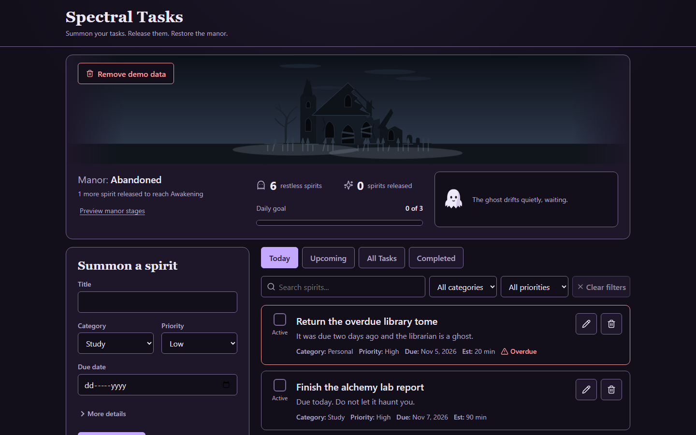
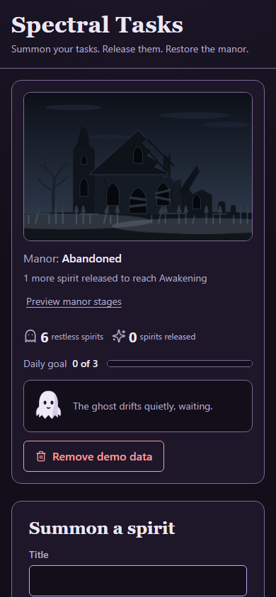

# Spectral Tasks

Your tasks are restless spirits haunting an abandoned manor. Release them by completing them, and the manor slowly comes back to life.

**Live:** https://spectral-tasks.vercel.app/





## Try it in 60 seconds

1. Open https://spectral-tasks.vercel.app/.
2. Click **Load demo data** to get a few sample spirits.
3. Tick three spirits to release them. At three you reach the daily goal and the ghost celebrates.
4. Click **Preview manor stages** under the stage name and pick 0 to 5 to see all six stages. **Back to my manor** returns to your real progress, which the preview never changes.

## Features

- **Tasks:** create, edit, delete, complete and reopen. Title is required; description, due date and estimated minutes are optional, plus category and priority.
- **Four views:** Today, Upcoming, All Tasks and Completed, with title search and category and priority filters. Overdue tasks are clearly marked.
- **Daily goal:** release 3 spirits a day, with a once-per-day celebration.
- **Six manor stages:** Abandoned, Awakening, Stirring, Illuminated, Restored, Enchanted. The stage comes from the completed tasks that exist right now, so reopening or deleting one can make the manor regress honestly.
- **Ghost companion:** reacts when you summon, release, and reach the daily goal.
- **Spirit-released moment:** a wisp rises from the finished task toward the manor, and the windows light up when a stage is gained.
- **Demo data:** load sample spirits, and remove them later without touching your own.
- **Preview manor stages:** look at any stage without changing your real progress. Nothing is saved.
- **Local storage:** everything lives in your browser's LocalStorage.
  - Corrupted data is backed up, then the app starts fresh.
  - Data written by a newer version puts the app in read-only mode, so it is never overwritten.
  - If storage is unavailable, the app keeps working in memory and says so.

## How it was built with Kiro

The project follows spec-driven development. The full spec lives in [`.kiro/specs/spectral-tasks/`](.kiro/specs/spectral-tasks/):

- [`requirements.md`](.kiro/specs/spectral-tasks/requirements.md): numbered acceptance criteria and edge cases.
- [`design.md`](.kiro/specs/spectral-tasks/design.md): architecture, data model, accessibility and responsive layout.
- [`tasks.md`](.kiro/specs/spectral-tasks/tasks.md): the implementation plan, worked through one task at a time.

Other choices that shaped the code:

- **Pure domain layer.** Task rules, dates, manor stages, ghost decisions and the reducer are plain functions, separate from React.
- **Property-based tests** with [fast-check](https://github.com/dubzzz/fast-check) for the domain logic, alongside example and integration tests.
- **Design-review loop.** Playwright screenshots at phone and desktop sizes, reviewed with the Impeccable design skill, drove the manor and ghost redesign and the layout passes. [`DESIGN.md`](DESIGN.md) records the resulting design system.

## Tech stack

React, TypeScript, Vite and plain CSS, with design tokens in `src/styles/tokens.css`. Runtime dependencies are only `react`, `react-dom` and `lucide-react`. The manor and ghost are hand-written inline SVG. Tests use Vitest and Testing Library; Playwright is a dev-only tool for design screenshots and browser QA.

## Run locally

```bash
npm install
npm run dev        # start the dev server
npm test           # run the tests once
npm run typecheck  # TypeScript check
npm run build      # typecheck and production build
```

## Accessibility

- Every feature works from the keyboard, with a visible focus ring and a skip link.
- Touch targets are at least 44 by 44 px on narrow screens.
- Changes are announced through polite live regions (spirit summoned, released, manor stage, preview).
- Reduced-motion preferences are honored: animations stop, and reactions stay available as text.
- Meaning never relies on color alone: overdue, completed and current states also carry text or an icon.
- Text contrast targets are checked by a unit test that reads the color tokens.

Full WCAG conformance has not been verified. It needs manual testing with assistive technology.

## Verification

**Tests.** `npm test` runs the unit, property-based and integration tests once (Vitest, jsdom). jsdom has no layout engine, so layout, focus and visual checks are covered by the browser QA below.

**Automated browser QA.** `scripts/qa/run.mjs` drives the production build with Playwright (`npm run build`, `npm run preview`, then `node scripts/qa/run.mjs`; install the extra browsers with `npx playwright install firefox webkit`). The cross-browser smoke check (load demo data, complete a task, refresh, check persistence and the console) was run on Chromium, Firefox, WebKit and Edge. WebKit is not Safari, and the Chrome and Safari columns of the checklist are not filled in. The results are recorded in [`docs/manual-qa.md`](docs/manual-qa.md), which shows which checks were automated (marked "(auto)") and which are still for a human. No screen-reader testing is recorded there.

**Performance.** Measured on 2026-11-08, production build, 500 tasks, Intel Core i5-8350U laptop (4 cores, 7.9 GB), Windows 11, headless Playwright Chromium 158 (not the stable Chrome channel), no CPU throttling:

| Check | Median | Target |
|-------|--------|--------|
| Complete a task (warm, median of 10) | 120 ms | 200 ms |
| Reopen a task (warm, median of 10) | 64 ms | 200 ms |
| Edit a task (warm, median of 10) | 88 ms | 200 ms |
| Delete a task (warm, median of 10) | 104 ms | 200 ms |
| Initial load to interactive dashboard (cold, median of 5) | 377 ms | 2000 ms |

These were automated, not read from the DevTools Performance panel, and the dashboard counts were not checked after loading each data set. See [`docs/performance.md`](docs/performance.md) for the method, the data sets and the full list of caveats.

## Known limitations

- Single device: data stays in one browser's LocalStorage. There are no accounts and no sync between devices or tabs.
- Manual QA and performance measurements are tracked in [`docs/manual-qa.md`](docs/manual-qa.md) and [`docs/performance.md`](docs/performance.md); see those files for what has and has not been measured.

## License

See [`LICENSE`](LICENSE).
